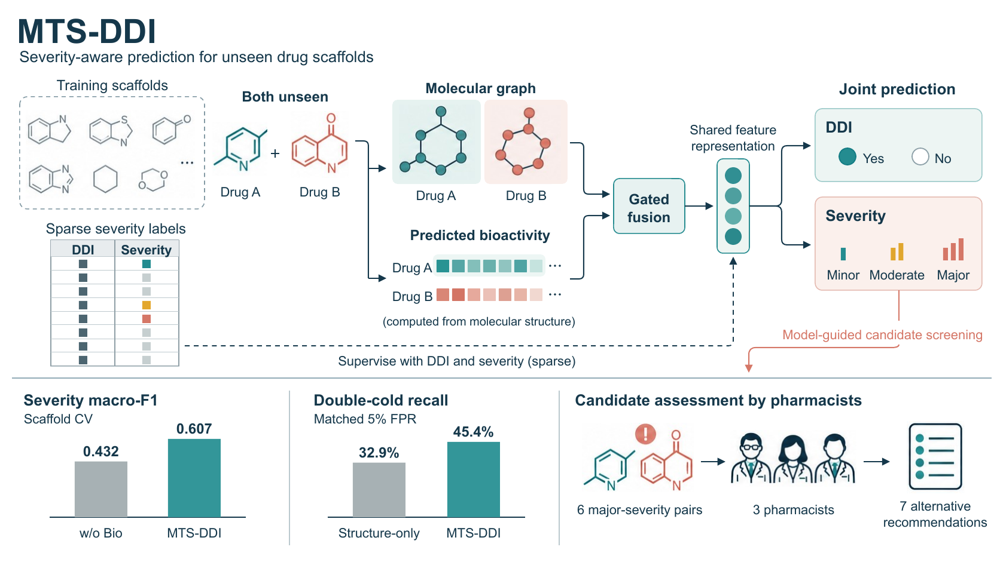
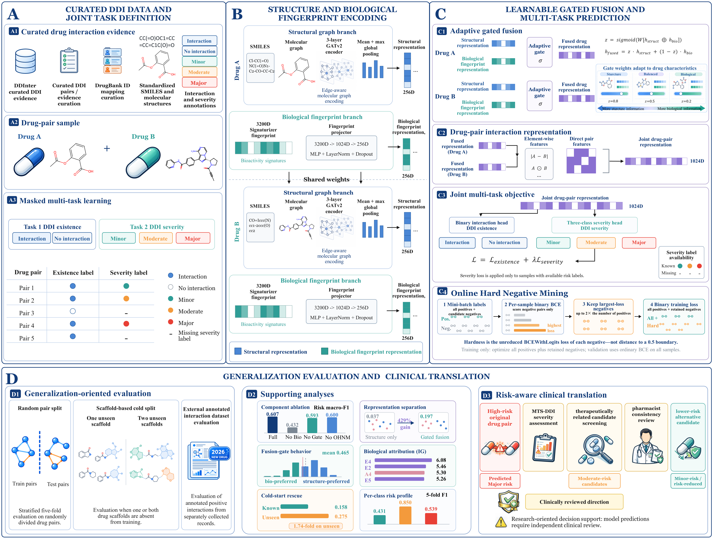

# MTS-DDI

MTS-DDI combines molecular graphs and predicted bioactivity signatures through gated fusion for joint prediction of drug–drug interaction existence and severity.

## Graphical abstract

## Method overview

**Figure 1.** Overview of data curation, multimodal encoding, gated fusion, multi-task prediction, evaluation and candidate assessment.
